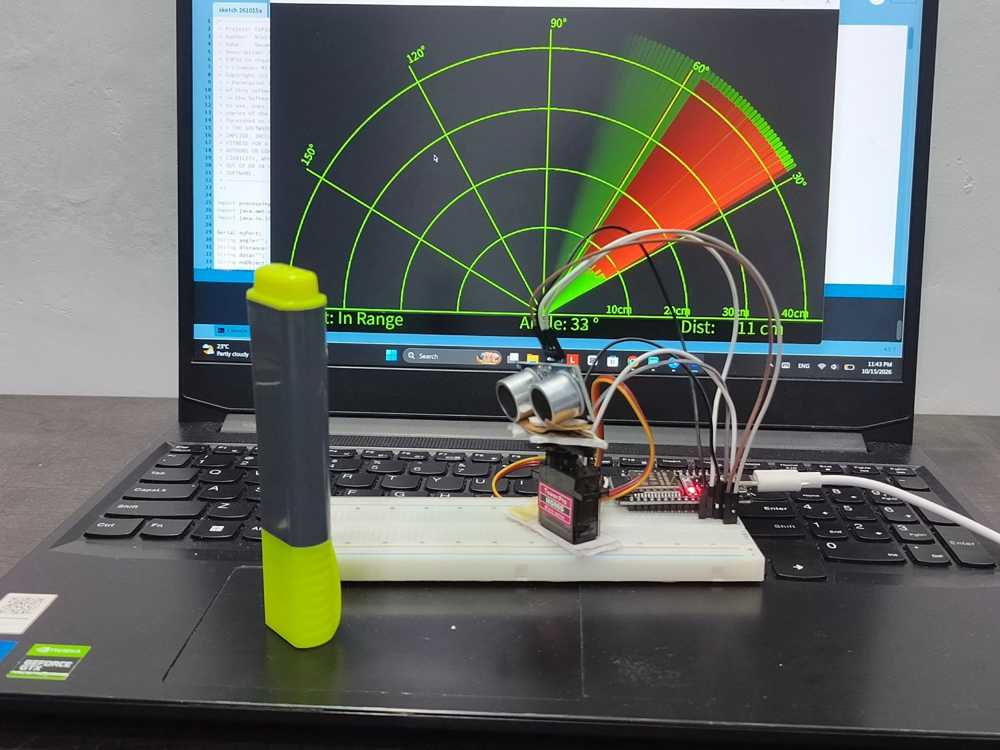
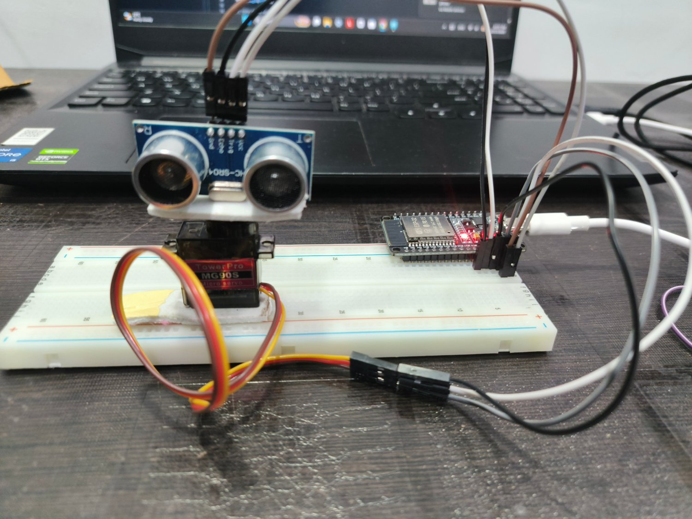
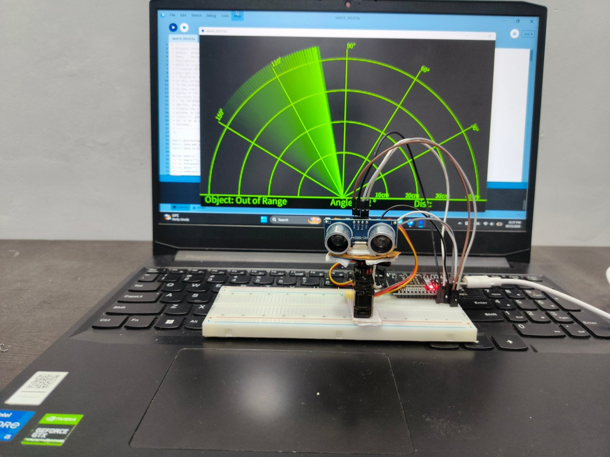

# ESP32 Ultrasonic Radar

A mini radar built with an ESP32, an HC-SR04 ultrasonic sensor and an MG90S servo. The servo sweeps the sensor across an arc, and a Processing sketch on the laptop draws a live radar screen showing the angle and distance of nearby objects.

## How it works
1. The servo turns the HC-SR04 sensor across the scanning arc.
2. At each angle, the ESP32 measures the distance to the nearest object.
3. The ESP32 sends the angle and distance to the laptop over USB serial at 115200 baud, in the form `angle,distance.`
4. The Processing sketch reads the data and draws the radar. Objects within 40 cm show up in red, and the screen shows "Out of Range" when nothing is detected.

## Hardware
- ESP32 development board
- HC-SR04 ultrasonic sensor
- MG90S micro servo
- Breadboard, jumper wires and a USB cable

## Files
- `esp32_radar.ino` is the ESP32 code that controls the servo, reads the sensor and sends the data
- `processing_radar.pde` is the Processing sketch that draws the radar display

## How to run
1. Upload `esp32_radar.ino` to the ESP32 using the Arduino IDE.
2. Close the Serial Monitor and open `processing_radar.pde` in Processing.
3. If it crashes, change `Serial.list()[0]` to `[1]` or `[2]` to pick the right USB port.
4. Press Run to start the radar.

## License
MIT
